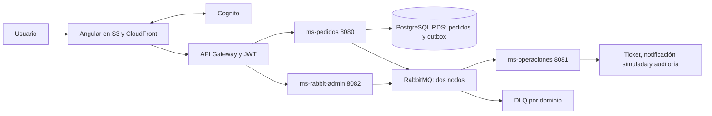

# Guion EP4 — 8 minutos

Usar este guion después de completar Cognito y la prueba integrada. Si una conexión real sigue pendiente, decirlo y mostrar la evidencia local correspondiente; no presentar mocks como integración cloud.

| Tiempo | Qué mostrar | Qué explicar individualmente |
|---|---|---|
| 0:00–0:45 | Diagrama y tres puertos | Angular envía access tokens; pedidos persiste y publica; operaciones consume; admin administra recursos. |
| 0:45–1:30 | Login y /pedidos | Cognito autentica, Gateway y Spring autorizan. Un guard mejora la interfaz pero no protege por sí solo. |
| 1:30–2:30 | Crear pedido; PostgreSQL y logs | La transacción guarda pedido y outbox; publisher confirm permite retirar el pendiente. El evento creado va a despacho y auditoría. |
| 2:30–3:20 | Cambiar estado | Topic pedido.estado.* llega a notificaciones y pedido.# a auditoría. Notificaciones es una simulación, no correo enviado. |
| 3:20–4:40 | Pedido [ERROR-DLQ], logs y Management | Intento inicial más dos reintentos; NACK con requeue=false, DLX y DLQ correspondiente. Mostrar contenido/eventId y conteos antes/después. |
| 4:40–5:40 | /rabbit-admin | Con scope admin, crear cola y exchange demo, crear binding, consultar y eliminar solo los recursos demo. Mostrar un 403 sin ese scope. |
| 5:40–6:30 | cluster_status y quorum_status | Dos nodos miembros con índices sincronizados. Dos réplicas requieren ambos nodos: no afirmar tolerancia a la caída de uno. |
| 6:30–7:20 | Clases y configuración | Topología central en YAML/config; controladores delegan servicios; DTOs validados; consumidor confirma después de guardar y deduplica eventId. |
| 7:20–8:00 | Pruebas, despliegue y límites | Tests locales, systemd, memoria, variables externas, S3/CloudFront y límites de las verificaciones reales. |

## Diagrama para explicar

## Preparación previa

- Abrir frontend, logs de servicios, Management mediante túnel local si está en EC2 y consulta de base de datos.
- Verificar que ambos nodos estén activos y que las colas principales tengan un consumidor cada una.
- Habilitar DEMO_FAILURE_ENABLED solo para el tramo de demostración; reiniciar operaciones tras cambiar la variable.
- Preparar un usuario/token de pedidos y uno con permiso administrativo según la política final. No mostrar el JWT en la pantalla grabada.
- Anotar conteos iniciales de las DLQ: pueden contener mensajes de demos anteriores. Comparar incrementos, no asumir cero.
- No detener un nodo durante la demo esperando disponibilidad: con dos réplicas no habrá mayoría.
- Si se cae la conexión cloud, explicar la incidencia y mostrar evidencia previamente capturada, identificándola como tal.

## Preguntas probables

**¿Por qué ACK manual?** Para confirmar después del resultado de negocio; si se pierde el canal antes del ACK puede haber redelivery.

**¿Por qué outbox?** Evita que el pedido se guarde sin dejar constancia de su evento si RabbitMQ falla. La publicación y el borrado del pendiente no son una transacción distribuida; puede haber duplicados.

**¿Cómo manejas duplicados?** Un archivo por eventId y dominio para una instancia de consumidores. El mismo contenido se omite; ID repetido con contenido distinto se rechaza. Varias instancias necesitarían un registro compartido transaccional.

**¿Por qué direct y topic?** Direct lleva pedido.creado a despacho; topic distribuye cambios y auditoría por patrones sin acoplar productor y consumidores.

**¿Qué diferencia hay entre DLX y DLQ?** El exchange enruta el rechazo mediante una clave; la cola conserva el mensaje para inspección. No hay reproceso automático de DLQ.

**¿Por qué scope admin?** Administrar RabbitMQ no equivale a borrar un pedido. Un scope separado distingue permisos; restringir quién lo recibe requiere la política final de Cognito o grupos.

**¿Qué significa 401 y 403?** 401 indica falta de autenticación válida; 403 indica que la identidad no tiene el permiso requerido.

**¿Qué pruebas no sustituyen los tests locales?** RDS real, callbacks Cognito, JWT firmado real, API Gateway, red y reinicio persistente. Los mocks no prueban esa infraestructura.

## Estado de evidencias antes del cierre Cognito

Confirmado por la consola del estudiante: clúster de dos nodos; seis colas quorum; consumo exitoso, archivos, dos reintentos y DLQ coherentes; administrador en 8082 y 401 sin token.

Confirmado localmente: compilación y pruebas automatizadas. Pendiente: autorización real con scopes, CRUD administrativo con token real, flujo frontend→RDS→outbox→RabbitMQ y despliegue cloud. Completar esta lista con fechas y resultados al terminar la integración.
